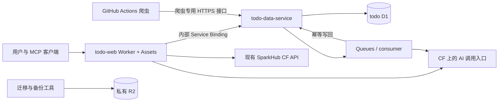

# todo-web 全站迁入 Cloudflare 与 D1 一次切换计划

更新：2026-10-22。状态：已实施 CF 预览、全量数据演练与反向回滚演练；生产流量及正式数据源尚未切换。实测状态见 [实施记录](cloudflare-migration-validation.md)，操作命令见 [运行手册](d1-migration.md)。

## 1. 目标与已经确认的范围

将 todo-web 的页面、SSR、Server Actions、API、MCP、数据库访问和后台业务任务迁到 Cloudflare。
旧 PostgreSQL 的全部业务数据一次全量迁入 D1，保留原 ID、关联、时间、软删除记录、URL、爬取状态和进度。
接受 Workers 付费方案，接受正式切换时暂停写入。

网站采用 vinext，参考现有 SparkHub 配置；先在 CF 预览环境完整验收，通过后才切生产。
保留现有访问密码与管理员／图库角色，切换时旧会话失效，用户重新登录；新会话必须由服务端验证。

爬虫运行环境本次继续使用 GitHub Actions；其数据库读写统一改走 Cloudflare 数据服务。
爬虫运行迁入 CF 是后续阶段，不将当前最长约 4 小时的 Playwright 任务直接搬进普通 Worker。

准备、预览和演练可以分阶段执行。正式停写、最终数据迁移、域名与所有写入端切换安排在同一个维护窗口，验收后统一开放。

历史图片和视频本体不存放在 PostgreSQL。用户已确认本次保留现有媒体文件、URL 和上传服务；
本次数据库迁移不搬迁历史文件本体，也不改爬虫的媒体上传目标。切换验收仍需验证原文件与缩略图 URL 可访问。
若后续迁入 R2，另行核实文件总量、读写权限、流量和旧地址兼容方案。

### 已确认的关键决定

以下五项已按依赖顺序逐项询问并由用户确认，作为实施依据。

| 决定 | 确认结果 | 状态 |
| --- | --- | --- |
| 网站框架 | 使用 vinext，参考 SparkHub 配置，真实 CF 预览完整验收通过后才切生产 | 用户已确认 |
| 历史媒体文件 | 本次保留现有文件、URL 和上传服务，R2 文件搬迁另列阶段 | 用户已确认 |
| AI 模型 | AI 接口、后台任务和密钥迁到 CF，继续使用现有模型供应方 | 用户已确认 |
| 旧 CustomCommand 的业务用途 | 旧记录完整保存于 todo D1，现用命令服务继续使用 SparkHub，本次不合并 | 用户已确认 |
| 登录会话切换 | 保持访问密码与角色使用方式，替换不可信旧 Cookie，旧会话失效，切换后重新登录 | 用户已确认 |

维护窗口的具体时长、时段和回退截止点在真实数据演练后确定，尚未承诺停机时长。

## 2. 当前事实与证据边界

- 两个仓库当前都在 `feature/cloudflare-d1`，此前改动尚未提交；原有工作区改动必须保留。
- 已实现的数据 Worker、爬虫 HTTP 接入和迁移工具可以复用，但“网站保持原部署”的方案已被本计划替代。
- 上一阶段完成了 Node/Next 本地构建、网站 41 项测试、爬虫 27 项回归、本地 D1 15 表样例导入校验。
  这些证据不等于全站已在 CF 运行，也不等于真实 PostgreSQL 数据已完成迁移。
- 旧库现已恢复连接。2026-10-22 16:09:15（北京时间）在同一个 Repeatable Read 只读快照内精确统计：
  16 张业务/关联表，共 315,693 行，数据库占用 202,170,368 字节（约 193 MiB，包含索引等开销）。
  D1 转换后的实际体积、索引和导入时间仍以演练结果为准。

| 源表 | 精确行数 |
| --- | ---: |
| Anniversary | 3 |
| Asset | 0 |
| Bookmark | 261 |
| BookmarkTag | 663 |
| CustomCommand | 19 |
| Media | 230,154 |
| Post | 83,378 |
| ProducerTag | 23 |
| Task | 91 |
| TaskTag | 24 |
| TrackItem | 18 |
| TrackMeta | 5 |
| _BookmarkToBookmarkTag | 869 |
| _ProducerToProducerTag | 42 |
| _TaskToTaskTag | 90 |
| producer | 53 |

同一快照的 Post 状态：UPLOADED 82,712、FAILED 614、PENDING 51、PROCESSING 1。
Media 的 230,154 行均为 UPLOADED。切换前必须重新统计，以最终导出 manifest 为准。

`CustomCommand` 已补入 Prisma 模型及 D1 迁移，19 条完整归档已通过全字段哈希校验，包括内嵌图片。严格导出器继续拒绝未知表和字段。

代码核对还确认：

- 按当前仓库代码与部署配置，命令服务指向 SparkHub 的 Cloudflare Worker，使用 APP_DB 内的 `custom_commands`。
  它与旧 PostgreSQL 的 `CustomCommand` 是不同的表。用户已确认旧记录完整保存在新 todo D1，
  现用命令服务继续使用 SparkHub，本次不合并。
- `src/api/ai/config.ts` 仍硬编码访问 Vercel AI 地址，必须迁移该调用入口。
- 爬虫 `src/utils/upload.ts` 将媒体上传到 `https://gallery233.pages.dev/upload`，保存接口返回的文件与缩略图 URL。
  该入口位于 CF Pages，但仅凭入口域名不能证明底层文件存储是 R2；数据库迁移本身不会复制媒体文件。
- `proxy.ts` 承担页面权限控制；`@serwist/next` 使用 webpack 构建 Service Worker；
  `linkTitleFetch.ts` 使用 Node DNS lookup、HTTP Agent 和流；任务标签存在响应结束后继续执行的 Promise。
  这些都是运行时迁移任务，不能靠构建成功替代验证。
- 代码检查发现 `src/api/validActions.ts` 直接写入角色字符串 Cookie；`proxy.ts`、
  `app/api/auth/status/route.ts`、`src/api/gallery/producer.ts` 等信任 `auth_role` 值，
  旧 `auth_token` 部分路径仅检查存在；任务 Server Actions 也缺少统一的用户身份校验。
  这是源码证据，尚未进行线上攻击验证。内部数据服务的凭据只能证明调用来自网站，不能代替终端用户鉴权。
- 已执行 `pnpm dlx vinext@latest check`：静态兼容评分 98%，21 项支持、1 项部分支持、0 项扫描问题。
  部分支持项是图片配置；扫描识别 12 个页面、7 个 Route Handler 和 Next 16 proxy。
  扫描没有证明 PWA、MUI/Emotion、SSRF 防护或 CF 原生预览中的实际行为。

## 3. 推荐目标架构

采用已确认的 vinext + Vite + Cloudflare Workers 作为网站部署主方案，参考 SparkHub 配置；延续 React、App Router、现有页面和业务语义。
Cloudflare 当前将 vinext 列为默认 Next.js 迁移路径；它仍处于 beta，必须先通过本项目的兼容和真实运行验收。
SparkHub 已有 vinext、Cloudflare Vite 插件和 Serwist Vite 插件的组合，可参考其接线方式，避免重复设计。
若 vinext 在预览阶段存在无法消除的阻断，提交实际证据并重新确认替代方案；不自动改为 OpenNext，也不在正式切换当天更换构建路径。

| 能力 | 目标 |
| --- | --- |
| 网站页面、SSR、Server Actions、API、MCP | 独立 todo-web Worker + Workers Static Assets |
| 数据库 | 独立 todo D1，包含全部 16 张旧业务/关联表及必要的新内部表 |
| 数据访问与原子业务操作 | 复用并完善 todo-data-service Worker |
| 网站访问数据服务 | 指向具名 WorkerEntrypoint 的内部 Service Binding/RPC |
| GitHub Actions 爬虫 | HTTPS 业务接口 + 爬虫专用令牌 |
| AI 标签、摘要等后台任务 | Cloudflare Queues + consumer + 失败队列 |
| 备份、迁移清单、站点需要持久化的新文件 | 私有 R2 |
| 命令服务 | 复用现有 SparkHub CF API/D1 |
| AI 调用入口 | Worker 内的服务端入口，移除 Vercel 域名硬编码 |
| 部署、配置、密钥、日志 | Workers Builds、Wrangler、Cloudflare Secrets、Workers Observability |

AI 入口与后台任务迁到 CF，模型密钥进入 CF Secrets；用户已确认继续使用现有模型供应方，
保持摘要、标签和润色行为，可通过 AI Gateway 统一接入。本次不更换为 Workers AI 推理；后续更换模型需另行评估。
第三方内容源、外部模型供应方和已确认暂留的 GHA 不等于网站仍托管在旧平台。

本地、预览、生产的 D1、Queues、R2 和 secrets 显式分开。
新项目的预览环境不得借用生产数据库；SparkHub 中已有的环境特殊规则不直接复制过来。
网站部署和数据 Worker 部署分别生成、检查并发布各自的产物；正式域名沿用现有域名，切换前核实现有路由与 DNS。

## 4. 实施顺序与阶段产物

### P0：保全现状与源数据清单

1. 为两个 feature 工作区制作可恢复快照，覆盖未提交和未跟踪代码，排除 `.env`、令牌和数据导出文件。
2. 核对现网域名、Cloudflare 账号、生产/预览环境、自动部署触发规则和所需权限，不在调研中修改线上资源。
3. 核对所有 PostgreSQL 写入端：旧网站、Server Actions、MCP、AI 后台任务、正在运行的爬虫和手工脚本。
4. 保存完整 PostgreSQL 结构/数据备份方案，包含原 Prisma 迁移历史；D1 使用自己的迁移历史，不执行旧 PG migrations。
5. 核对 `CustomCommand` 所有字段、两个枚举、默认值、唯一索引和普通索引。

完成条件：16 表清单、所有写入端、受影响的域名/应用与备份恢复路径明确，旧环境仍可继续提供服务。

### P1：补齐 D1 全量迁移能力

1. 补齐 `CustomCommand` 的 D1 模型和迁移，保留 19 行历史记录及审核、owner、时间等字段。
2. 将迁移清单区分为“16 张旧业务/关联表”和“新平台内部表”；
   AI job/outbox 等新增表不要求旧 PG 存在，未知的旧表仍然导致失败。
3. 保留一致快照导出、按外键依赖排序导入、SQL 文件校验和、全字段 SHA-256、禁止非空目标导入等保护。
4. 大表校验改为主键游标分页；复合主键关联表使用复合游标，避免 OFFSET 遍历大表。
   网站通用公网查询关闭后，正式核验工具通过 Wrangler/D1 管理通道读取目标；
   管理凭据只用于迁移操作，不放入网站、爬虫或浏览器。
5. 验证 ID、枚举、空值、布尔、日期时区、浮点字段、软删除和 URL 转换；验证 Media 后续自增 ID 不碰撞。
6. 大记录超过 SQL 导入语句限制时给出明确处理方案，不能裁剪内容；导入跨文件不视作整体事务，失败后重建空目标再演练。
7. 增补数据库切换后回迁 PostgreSQL 的工具和验证路径，覆盖新增、修改及硬删除，不能仅依赖 updateTime 推断增量。

完成条件：16 表真实快照能导入隔离 D1，逐表行数及全字段校验一致；故障恢复和逆向回迁通过演练。

### P2：网站运行环境迁到 Workers

1. 锁定经验证的 vinext/Vite/React/Serwist 版本组合，处理 ESM、配置文件、脚本和构建产物路径。
2. 将 Serwist 接线从 webpack 插件迁为 Vite 插件；保留安装、离线壳和升级提示行为。
   首发保留当前 `images.unoptimized: true`，核对 remotePatterns、SVG/CSP 和原媒体 URL；
   图片变换能力按实际需求配置，不把静态检查的部分支持当作已验证失败或已验证可用。
3. 验证 MUI/Emotion、主题、RSC、Server Actions、表单、路由、登录 proxy、Cookie 和 MCP。
   API 与 Server Actions 自身也必须验证权限，不能只依赖页面跳转保护。
   保留访问码与角色的业务区分，统一验证具有服务端可信性的会话及有效期，不再信任裸角色 Cookie 或仅存在的旧令牌。
   每个私有读写入口都验证当前用户权限；生产鉴权密钥缺失时不得自动授予管理员权限。
   验收覆盖伪造角色/旧令牌、未登录直接调用 Action、图库角色访问管理员数据、过期会话与退出登录。
   按已确认决定使旧会话失效，引导用户重新登录；不能在没有可信凭证的情况下直接升级旧会话。
4. 迁移链接标题/来源解析的网络实现：Workers `node:dns.lookup` 不可用；
   使用适合 Workers 的网络接口，并保留私网拒绝、逐跳重定向校验、响应大小限制和超时。
   不能将一次 DNS 预检查当成实际连接安全的证明。
5. 核对真实运行路径中的 Node-only/native 依赖；未被引用的本地脚本留在构建外，真正的持久化改走 D1/R2。
6. 移除 Vercel Speed Insights 接线、Vercel 专属部署配置与 AI 地址硬编码。
7. 对 23 万媒体量级的图库分页、随机模式和筛选做基准测试；移除每页全量拉取所有 ID 的路径，
   采用能利用索引的分页/抽样方案，并验证现有随机模式的顺序与翻页语义。

完成条件：生产形态的 workerd 预览通过，而不只是 `next dev` 或 Node 构建通过。

### P3：内部数据调用与后台任务统一

1. 网站通过具名 WorkerEntrypoint/Service Binding 调用数据层；浏览器不获得 D1 或服务凭据。
2. 公网数据入口只开放爬虫所需业务操作；关闭原先为外部部署网站准备的通用公网查询入口。
3. 所有入口复用同一个维护/只读控制，覆盖 RPC、HTTP、MCP、后台 consumer 和调度器。
4. AI 标签和摘要使用 Queues。待处理任务与业务变更在同一 D1 batch 写入 outbox，
   发布器可重试投递，consumer 以 job ID 幂等，并检查目标记录版本，避免覆盖用户后续手动修改。
5. 配置有限重试、失败队列和人工重试入口；状态读取有界返回，不通过无限轮询把一个 Worker 请求悬挂。
6. 按已确认决定复用 SparkHub 现有命令服务；旧 `CustomCommand` 完整保存在 todo D1，
   本次不合并、不覆盖现役 `custom_commands`。

完成条件：公网权限与内部权限隔离，重复投递无重复副作用；维护时不会有“页面已停写但后台仍在写”的遗漏。

### P4：隔离预览与完整演练

1. 建立独立 CF 预览环境，不绑定正式域名、不触发生产爬虫、不消费生产任务。
2. 导入真实只读快照，验证全部 16 表；这些快照仍然包含真实业务数据，预览必须受控访问。
3. 在 workerd/CF 预览执行 SSR、写入、登录、角色、MCP、PWA、AI、命令服务和爬虫接入验收。
4. 专门覆盖：书签关系写入失败回滚、任务标签恢复、并发来源修改、过期 AI 结果拒绝覆盖、
   爬虫唯一领取、媒体去重、部分上传进度保留和 PROCESSING 超时回收。
5. 测量真实导出、导入、校验和回迁耗时，核实目标库/索引体积、Worker 包体、CPU、内存与查询开销。
6. 演练域名切换、旧站残留请求、PWA 旧客户端、队列暂停/恢复，以及回退。

完成条件：提供实际运行记录和数据校验结果，据此确定正式维护窗口长度；未通过的项目不得带入正式切换。

## 5. 唯一一次正式维护窗口

| 顺序 | 动作 | 放行条件 |
| --- | --- | --- |
| 1 | 锁定待发布版本，确认备份和回退版本；目标网站/数据服务保持维护模式 | 新旧版本和资源清单可定位 |
| 2 | 关闭旧网站写入、MCP 写入及旧后台任务；暂停 Producer/Consumer 定时与手动入口，等待在途任务结束 | 无遗漏的旧写入端、无活动写事务 |
| 3 | 生成完整旧库备份和最终一致快照，记录行数、状态分布、文件/字段校验和 | manifest 完整且可验证 |
| 4 | 从空目标导入最终快照，目标后台任务继续暂停 | 全部文件成功，无忽略表或字段 |
| 5 | 完成 16 表全字段校验、外键/唯一约束与 ID 序列检查 | 所有表 PASS，无孤立关系 |
| 6 | 用受控入口验证 CF 网站只读页面、登录、MCP 读取、媒体 URL 和上游服务 | 无功能阻断 |
| 7 | 将正式域名/路由、网站绑定、爬虫 Secrets 指向同一套 CF 生产环境 | 旧站仍拒绝写入，缓存中的旧客户端不能再写旧 PG |
| 8 | 进行受控 CRUD 与后台任务验收，再统一开放用户写入和后台任务 | 写入及幂等检查通过 |
| 9 | 先手动运行一次 Producer、Consumer，再恢复定时任务 | 新帖子、媒体和任务状态正常，已上传媒体无重复上传 |

当前快照有 1 条 PROCESSING。正式窗口优先等待在途 Consumer 结束；如果必须停止，
迁移仍原样保留状态和已落库媒体，恢复后沿用原有超时回收规则，不批量重置为 PENDING。

D1 Worker 的只读开关无法阻止仍连接旧 PG 的旧站写入。因此停旧写入必须在旧应用或数据库权限层真正生效，
并在最终快照前确认；不能只暂停 GHA 的 cron 而放任已运行 Consumer 继续工作。

## 6. 回滚与验收

恢复目标写入前，若导入、校验、预览或域名检查失败，继续保留维护模式，切回旧站与旧数据库后再解除旧写入限制。
旧站、旧库及备份在验收完成前保留，不自动删除。

目标已产生新写入后，先暂停新站、爬虫和所有 consumer，导出 D1 最新业务数据并回迁 PG，
覆盖新增、修改和硬删除；待数据及未完成后台任务核验后再开放旧站。
不能直接把域名切回旧库而丢掉切换后的数据。

正式验收必须同时满足：

- 16 张旧业务/关联表在恢复写入前逐表行数与全字段 SHA-256 相同，原 ID、URL 和关联保持。
- 所有页面、SSR、Server Actions、API、MCP 在 CF 环境可用；MUI/Emotion 无 hydration 异常。
- 管理员、图库角色、未登录用户、MCP 与爬虫分别符合既有权限边界。
  伪造 Cookie、直接调用私有 Action 和过期会话均不能绕过服务端鉴权，生产缺少鉴权配置时不能开放管理员权限。
- PWA 新旧客户端升级正常；个人数据、认证响应和写入操作不进入公共缓存。
- AI 标签/摘要和命令功能不再依赖 Vercel 上的应用服务；外部内容源/模型依赖均有清单。
- 爬虫在 GHA 正常运行，但数据库读写均进入 CF；故障保留进度，已上传媒体不重复上传。
- 新旧部署、全部已知应用与后台入口均不再向旧 PG 写入；恢复定时任务后再复核。
- 配置、Secrets、Workers Builds 和发布产物一致；预览与生产资源隔离。
- 整个维护过程有时间记录、错误记录、校验报告及可执行回退步骤。

## 7. 本轮产物与后续边界

本轮方案审查已确认网站框架、媒体保留范围、AI 模型供应方、旧命令记录用途和重新登录策略。
当前没有需要继续向用户追问的范围选择；维护窗口与回退截止点待演练数据形成后再确定。
Cloudflare 账号、域名、权限和实际资源状态仍须在 P0 实查，容量、成本与耗时仍须在 P4 实测；
这些待核实项不代表迁移已准备就绪，任何实际阻断都必须在正式切换前解决。

实施现已开始，并完成预览资源、真实全量导入与回滚演练。其余检查以实施记录为准。
正式维护窗口尚未开始，不在准备和演练阶段提前切走正式流量。

## 参考

- [Cloudflare Next.js / vinext 指南](https://developers.cloudflare.com/workers/framework-guides/web-apps/nextjs/)：推荐路径、beta 状态与兼容检查。
- [vinext 官方仓库](https://github.com/cloudflare/vinext)：webpack 插件需换为 Vite 接线，静态扫描不代替运行验收。
- [Service Binding RPC 与具名入口](https://developers.cloudflare.com/workers/runtime-apis/bindings/service-bindings/rpc/)：内部 Worker 调用边界。
- [Workers DNS 支持](https://developers.cloudflare.com/workers/runtime-apis/nodejs/dns/)：`lookup` 等接口不能直接沿用。
- [Workers 文件系统](https://developers.cloudflare.com/workers/runtime-apis/nodejs/fs/)：临时文件不提供跨请求持久化。
- [waitUntil 生命周期](https://developers.cloudflare.com/workers/runtime-apis/context/)：耗时后台任务改用 Queues。
- [Queues 投递语义](https://developers.cloudflare.com/queues/reference/delivery-guarantees/)：至少一次投递要求业务幂等。
- [D1 平台限制](https://developers.cloudflare.com/d1/platform/limits/)：体积及执行限制以实测和发布时文档为准。

本地依据：`todo-web` 当前代码、旧 PG 只读结构/计数查询、vinext 静态扫描；
以及 SparkHub 的 `apps/web/vite.config.ts`、`apps/api/src/command/schema.ts` 和仓库 CF 部署规范。
